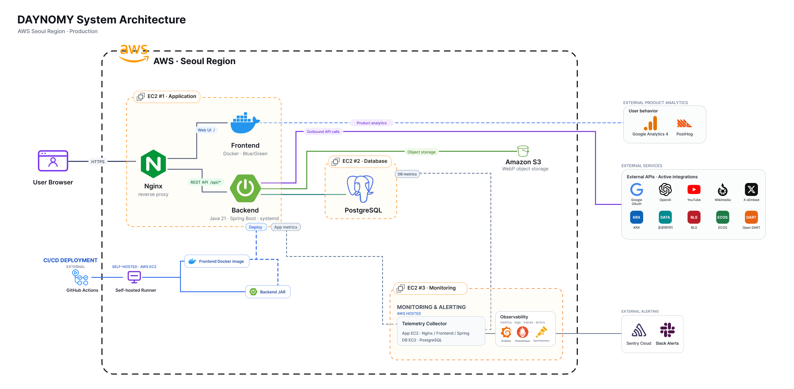

<div align="center">

  <h1>DAYNOMY</h1>

  <p>
    <b>내 투자 기록과 시장 정보를 연결하는 포트폴리오 분석 서비스</b>
  </p>

  <p>
    보유 자산이 지금 어떤 상태인지, 시장의 변화가 내 포트폴리오에 어떤 영향을 주는지 확인해 보세요.
  </p>

  <p>
    <a href="https://daynomy.com"><b>서비스 바로가기</b></a>
    ·
    <a href="https://github.com/woowacourse-teams/2026-DAYNOMY">GitHub 저장소</a>
  </p>

</div>

---

## DAYNOMY는 어떤 서비스인가요?

DAYNOMY는 사용자의 **보유 자산과 매수·매도 기록을 바탕으로 포트폴리오를 분석**합니다.

단순히 현재 수익률을 보여주는 데서 그치지 않습니다. 경제 뉴스와 시장 정보를 보유 종목에 연결하고, 포트폴리오에 어떤 영향을 줄 수 있는지 분석 근거와 함께 제공합니다. 사용자는 투자 당시의 판단과 결과를 기록하며 자신의 투자 과정을 돌아볼 수 있습니다.

DAYNOMY는 사용자가 다음 질문에 답할 수 있도록 돕습니다.

- 내 자산은 어떤 종목에 집중되어 있을까?
- 최근 시장 변화가 내 포트폴리오에 어떤 영향을 줄까?
- 이전 분석 이후 무엇이 달라졌을까?
- 나는 어떤 이유로 투자했고, 그 판단의 결과는 어땠을까?

> DAYNOMY가 제공하는 뉴스, 시세와 분석 결과는 정보 확인을 위한 참고 자료이며 투자 자문이나 금융상품 매매 권유가 아닙니다.

## 핵심 기능

### 1. 포트폴리오 AI 분석

- 보유 자산과 거래 기록을 기반으로 포트폴리오 분석
- 포트폴리오 전체 요약과 종목별 영향 분석
- 분석에 사용한 근거와 출처 제공
- 보유 자산 변경 감지 및 새로운 분석 안내
- 최신 시장 정보를 반영한 분석 근거 재확인
- 동일한 종목 분석 재사용과 중복 분석 방지
- 회원 분석 결과 저장 및 변경 이력 관리
- 비회원 1회 분석 체험

분석 조회와 AI 실행을 분리했습니다. 사용자가 저장된 결과를 확인할 때는 AI를 다시 호출하지 않으며, 포트폴리오가 달라졌거나 새로운 근거를 확인할 때만 별도의 분석을 요청합니다.

### 2. 자산과 투자 기록

- 국내·미국 주식 및 ETF 관리
- 매수·매도 거래 기록과 일괄 편집
- CSV를 이용한 보유 현황 가져오기
- 보유 수량과 평균 매입가 계산
- 평가금액, 손익과 자산 구성 확인
- 국내·미국 종가와 환율을 반영한 자산 추이
- 투자 당시의 보유 이유와 결과 복기

### 3. 맞춤형 경제 콘텐츠

- 경제 뉴스, 인물 게시물과 외부 자료 탐색
- 보유 종목과 관련된 소식 확인
- 기사·인물·외부 콘텐츠 통합 검색
- 최신순·인기순 콘텐츠 정렬
- 종목별 관련 콘텐츠와 분석 근거 확인
- 자동 수집 콘텐츠의 관리자 검수 후 공개

### 4. 투자 리그

- 주간 수익률 기반 투자 리그
- 공개 투자자의 포트폴리오와 투자 기록
- 일별·주간 성과와 위험 지표 확인
- 보유 이유와 투자 복기 공유
- 관심 투자자 팔로우
- 거래일·종가 수집 상태를 반영한 집계 안내

## 포트폴리오 분석 흐름

```text
보유 자산·거래 등록
        ↓
현재 자산 구성과 손익 계산
        ↓
포트폴리오 관련 시장 정보 탐색
        ↓
전체 요약·종목별 영향·분석 근거 제공
        ↓
자산 또는 근거 변경 감지
        ↓
분석 재확인 및 투자 판단 복기
```

## Team DAYNOMY

DAYNOMY는 4명의 개발자가 기획부터 프론트엔드, 백엔드, 테스트와 배포까지 함께 만든 프로젝트입니다.

각자 핵심 도메인을 중심으로 개발하되, 하나의 기능이 사용자 화면부터 서버와 데이터베이스까지 완결되도록 Full-stack으로 협업했습니다.

|                                                        이해선                                                        |                                                         최서영                                                         |                                                                 김희영                                                                 |                                                       박효미                                                       |
| :------------------------------------------------------------------------------------------------------------------: | :--------------------------------------------------------------------------------------------------------------------: | :------------------------------------------------------------------------------------------------------------------------------------: | :----------------------------------------------------------------------------------------------------------------: |
| <a href="https://github.com/haeseonlee"></a> | <a href="https://github.com/choiyoung69"></a> |         <a href="https://github.com/Huiyeongkim"></a>         | <a href="https://github.com/parkhyomi"></a> |
|                                                      Full Stack                                                      |                                                       Full Stack                                                       |                                                               Full Stack                                                               |                                                     Full Stack                                                     |
|     <b>포트폴리오 AI 분석</b><br />분석 생성·저장·갱신<br />시장 분석·키워드 분석<br />근거 검증·중복 실행 방지      |         <b>포트폴리오 · 자산 데이터</b><br />거래 원장·수익률<br />국내·미국 주식 및 ETF<br />인프라 모니터링          | DAYNOMY 이슈 제작·발행<br />YouTube·Threads·X 게시물 수집 자동화<br />수집 콘텐츠 검수·사용자 피드백 관리<br />로그 기반 운영 모니터링 |         <b>투자 리그 · 검색</b><br />리그 집계·순위 최적화<br />통합 검색·웹 접근성<br />프론트엔드 CI/CD          |

### 공통 업무

- 서비스 요구사항과 API 명세 공동 설계
- 프론트엔드와 백엔드를 연결한 기능 단위 개발
- 코드 리뷰와 ADR을 통한 기술 의사결정 기록
- 단위·통합·E2E 및 부하 테스트 자동화
- GitHub Actions 기반 CI/CD와 운영 모니터링

## 기술 스택

### Frontend

| 분류             | 기술                                |
| ---------------- | ----------------------------------- |
| UI               | React 19                            |
| Language         | TypeScript 6                        |
| Build            | Vite 8                              |
| Routing          | React Router 7                      |
| API              | Axios                               |
| Test             | Vitest, Testing Library, Playwright |
| Quality          | Oxlint, Prettier                    |
| Analytics        | Google Analytics 4, PostHog         |
| Error Monitoring | Sentry                              |

### Backend

| 분류              | 기술                               |
| ----------------- | ---------------------------------- |
| Language          | Java 21                            |
| Framework         | Spring Boot 4.1                    |
| Database          | PostgreSQL 17                      |
| ORM               | Spring Data JPA                    |
| Migration         | Flyway                             |
| Security          | Spring Security, Google OIDC, JWT  |
| API Documentation | Springdoc OpenAPI                  |
| Test              | JUnit, RestAssured, Testcontainers |
| Storage           | AWS S3                             |

### Infrastructure & Operations

| 분류       | 기술                 |
| ---------- | -------------------- |
| CI/CD      | GitHub Actions       |
| Container  | Docker               |
| Web Server | Nginx                |
| Metrics    | Prometheus, Grafana  |
| Logging    | Grafana Alloy        |
| Tracing    | OpenTelemetry, Tempo |
| Load Test  | k6                   |

## 시스템 아키텍처



운영 환경은 AWS 서울 리전에 구성되어 있습니다. 애플리케이션, 데이터베이스와 모니터링 서버를 분리하고 GitHub Actions와 Self-hosted Runner를 통해 배포합니다.

## 프로젝트 구조

```text
2026-DAYNOMY/
├── backend/          # Spring Boot API 서버
├── frontend/         # React 웹 애플리케이션
├── monitoring/       # 메트릭·로그·트레이싱 및 알림 설정
├── loadtest/         # k6 부하 테스트
├── docs/             # 접근성·부하 테스트 등 공통 문서
├── .github/          # CI/CD 워크플로
└── scripts/          # 저장소 공통 스크립트
```

## 로컬 실행

### 요구사항

- JDK 21
- PostgreSQL 17
- Node.js 20.19 이상 또는 22.12 이상
- Git

### 저장소 복제

```bash
git clone https://github.com/woowacourse-teams/2026-DAYNOMY.git
cd 2026-DAYNOMY
```

### Backend

PostgreSQL 데이터베이스를 생성합니다.

```sql
CREATE DATABASE daynomy;
```

`backend/.env` 파일에 로컬 실행에 필요한 값을 설정합니다.

```dotenv
DB_URL=jdbc:postgresql://localhost:5432/daynomy
DB_USERNAME=<database-username>
DB_PASSWORD=<database-password>

GOOGLE_CLIENT_ID=<google-client-id>
GOOGLE_CLIENT_SECRET=<google-client-secret>
JWT_SECRET=<jwt-secret>

AWS_S3_PUBLIC_BASE_URL=<public-image-base-url>
PUBLIC_DATA_SERVICE_KEY=<public-data-service-key>

FRONTEND_BASE_URL=http://localhost:5173
COOKIE_SECURE=false
```

AI 분석, 이미지 업로드와 외부 콘텐츠 수집 기능에는 추가 환경변수가 필요합니다. 자세한 설정은 [백엔드 README](./backend/README.md)를 확인해 주세요.

```bash
cd backend
./gradlew bootRun
```

- API 서버: `http://localhost:8080`
- Swagger UI: `http://localhost:8080/swagger-ui.html`
- OpenAPI: `http://localhost:8080/v3/api-docs`
- Health Check: `http://localhost:8081/actuator/health`

### Frontend

새 터미널에서 프론트엔드를 실행합니다.

```bash
cd frontend
npm install
npm run dev
```

프론트엔드는 `http://localhost:5173`에서 실행됩니다. 로컬 개발 환경에서는 Vite가 `/api`, `/oauth2`, `/login/oauth2` 요청을 백엔드로 전달합니다.

Google OAuth의 로컬 리디렉션 URI는 다음과 같습니다.

```text
http://localhost:8080/login/oauth2/code/google
```

자세한 설정은 [프론트엔드 README](./frontend/README.md)를 확인해 주세요.

## 테스트와 검증

### Backend

```bash
cd backend

# 코드 포맷과 전체 테스트
./gradlew spotlessCheck test

# PR 수준 전체 검증
./gradlew clean build
```

### Frontend

```bash
cd frontend

# 포맷·린트·타입·테스트
npm run format:check
npm run lint
npm run typecheck
npm test

# 프로덕션 빌드
npm run build
```

브라우저 E2E 테스트는 Chromium을 설치한 뒤 실행합니다.

```bash
npx playwright install chromium
npm run build
npm run test:e2e
```

## 관련 문서

- [백엔드 개발 문서](./backend/README.md)
- [프론트엔드 개발 문서](./frontend/README.md)
- [프론트엔드 릴리스 절차](./frontend/RELEASING.md)
- [프론트엔드 변경 이력](./frontend/CHANGELOG.md)
- [백엔드 ADR](./backend/docs/adr)
- [프론트엔드 ADR](./frontend/docs/adr)
- [모니터링 운영 문서](./monitoring/docs)
- [부하 테스트 문서](./docs/loadtest)
- [팀 개발 규칙](./AGENTS.md)

## 개발 원칙

- API 명세와 관련 ADR, 기존 코드를 먼저 확인합니다.
- 기능과 구조 변경 전 구현 방향과 범위를 공유합니다.
- 요청받지 않은 리팩터링이나 선제적인 추상화를 추가하지 않습니다.
- 변경에 필요한 테스트와 문서만 함께 수정합니다.
- 실패한 테스트를 삭제하거나 비활성화하지 않습니다.
- 민감정보와 인증 정보를 코드, 로그와 커밋에 포함하지 않습니다.

커밋 메시지는 `타입: 한국어 설명` 형식을 사용합니다. `main`, `dev` 브랜치에는 직접 커밋하지 않으며 강제 푸시하지 않습니다.

---

<div align="center">
  <b>매일의 경제를 나에게 가까운 순서로, DAYNOMY</b>
</div>
