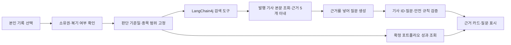

# 투자리그 근거 기반 AI 복기 코치 기술명세서

**상태:** BE·FE 기능 구현 및 자동 테스트 완료, 모델 품질 평가 전 · **작성일:** 2026-10-28 · **관련 문서:** [기획서](./league-ai-review-product.md)

## 기술 선택과 변경 범위

기존 Java 21·Spring Boot 4 백엔드에서 **LangChain4j 기반의 제한된 검색 증강 생성(RAG)** 흐름을 구현했다. LangChain4j의 ContentRetriever와 AI Service 읽기 전용 도구를 기존 기사 검색에 연결했다. 최종 질문은 OpenAI Responses의 엄격한 JSON Schema로 생성하고 서버에서 참조 ID를 검증한다. 기술 이력에는 **LangChain4j·키워드 기반 RAG·도구 호출·구조화 출력·출처 검증**을 적을 수 있다. 오프라인 품질 평가를 완료하기 전에는 평가 성과를 주장하지 않는다. Python LangChain 서비스, 벡터 DB, 임베딩 인덱스는 사용하지 않는다. [LangChain4j RAG](https://docs.langchain4j.dev/tutorials/rag/), [도구 호출](https://docs.langchain4j.dev/tutorials/tools/)

| 기존 자산                                                                             | 사용 방식                                                                                          |
| ------------------------------------------------------------------------------------- | -------------------------------------------------------------------------------------------------- |
| InvestmentDecisionRepository.findByIdAndPortfolioMemberId, InvestmentReviewRepository | 소유권·복기 0건 확인과 판단 문장 조회                                                              |
| AssetContentRepository의 종목과 기사 연결, ContentSearchService의 DAYNOMY 검색        | 후보 기사 검색. 기존 검색은 제목·기사 본문을 찾지만 검색 응답에는 본문이 없으므로 상세를 다시 읽음 |
| NewsService.getNewsDetail, News의 발행 상태·본문·발행일·출처                          | 실제 발행된 기사의 텍스트와 내부 링크 구성                                                         |
| WeeklyLeaderboardRepository                                                           | 판단 마지막 저장일 이후에 시작한 최근 3주 내 확정된 WEEKLY_RETURN의 본인 포트폴리오 성과           |
| MyLeagueController, InvestmentRecords                                                 | 기존 본인 전용 API와 두 복기 화면의 진입점                                                         |
| 기존 LeagueReviewGuideRateLimiter                                                     | 회원별 요청 횟수와 동시 실행 제한                                                                  |

기존 review-guide 경로를 유지하되 응답에 근거 목록과 질문별 참조를 추가한다. BE 브랜치의 단발성 OpenAI 클라이언트와 FE 브랜치의 질문 표시를 이 계약에 맞게 교체한다. 기존 복기 저장 API·테이블과 공개 투자자 API는 변경하지 않는다. 알림 정책용 V57 마이그레이션으로 league_review_reminders를 추가하며 기존 복기 데이터 구조는 유지한다.

## 처리 흐름



1. **인증·범위 확정:** 기존 인증 주체의 memberId로 transactionId 소유권을 확인하고 복기가 있으면 409를 반환한다. 종목 ID, 자산명, InvestmentDecision.updatedAt, 이유와 선택 판단 항목을 서버에서 읽는다. 클라이언트가 보낸 종목명·판단 문장·회원 ID는 사용하지 않는다.
2. **검색 범위:** 결정 마지막 저장 시각보다 늦고 요청 시각보다 이른 최근 90일의 DAYNOMY 발행 기사만 사용한다. AssetContent의 assetId↔newsId 연결을 우선하고, 기존 ContentSearchService의 DAYNOMY 제목·본문 검색으로 누락 후보를 보완한다. 키워드 보완 검색에는 서버가 자산명을 필수 검색어로 넣고, 종목 연결이 없는 결과도 제목이나 본문에서 자산명을 확인한다. 두 조회는 각각 DB에서 최대 20개를 가져오도록 제한하며 기존 무제한 종목 콘텐츠 조회 메서드를 그대로 호출하지 않는다. 후보는 중복 제거 후 최근성과 판단 문장의 초점 단어 일치도를 고려해 최대 5개로 제한한다. 순위 규칙은 코드에서 결정적으로 구현하고 평가셋으로 검증한다.
3. **제한된 도구 호출:** LangChain4j AI Service는 요청별로 생성한 읽기 전용 searchPublishedNews(focusTerm) 도구만 사용한다. 모델이 정할 수 있는 값은 판단 문장에서 뽑은 짧은 초점 단어뿐이다. 검색어의 자산명과 실제 assetId·발행 상태·기간·최대 개수는 서버가 고정하며 임의 URL·SQL·회원 ID는 인자로 받지 않는다. 도구 호출은 최대 2회이고 호출하지 않거나 부적절한 단어를 보내면 서버가 자산명으로 기본 검색을 수행한다. 도구 객체에 회원 상태를 전역 가변 필드로 보관하지 않는다.
4. **기사 본문 확인:** 검색 결과의 NEWS ID마다 NewsService.getNewsDetail로 다시 발행 상태를 확인한다. HTML을 텍스트로 정리해 모델에는 기사당 관련 문맥 최대 800자, 합계 최대 4,000자만 전달한다. 화면의 발췌는 실제 본문의 연속된 텍스트 최대 160자로 서버가 만든다. X·Threads·YouTube 검색 결과는 본문이 없으므로 이번 버전의 근거에서 제외한다.
5. **RAG 생성:** 모델 입력은 최소화한 판단 문장과 검증한 기사 ID·제목·발행일·발췌 문맥이다. 기사 본문과 판단 문장은 명령이 아닌 데이터로 취급한다. 모델은 세 복기 칸의 질문과 각 질문이 참조한 기사 ID만 구조화 출력한다. 기사에 없는 사건·수치·날짜, 기사와 포트폴리오 성과의 인과관계, 매수·매도 지시는 만들지 않도록 지시한다.
6. **서버 검증:** 질문 3개가 모두 비어 있지 않고 160자 이하이며 물음표로 끝나는지 확인한다. 요청 JSON Schema에도 한 줄·160자·ASCII 물음표 종료 패턴을 명시하여 평서문·줄바꿈·물음표 뒤 괄호로 인한 형식 실패를 줄인다. 관련 기사가 없을 때도 직접 확인할 사실이나 자료를 묻는 질문으로 생성한다. 참조 ID는 이번 요청에서 읽은 발행 기사 ID 집합에 포함되어야 한다. 중복·누락·형식 오류·명백한 매매 지시는 503으로 처리한다. AI가 만든 기사 제목·URL·발췌는 응답에 사용하지 않고 서버에서 읽은 값만 반환한다. 유효한 ID라도 문장의 의미가 출처와 일치하는지는 자동 보장되지 않아 오프라인 평가가 필요하다.
7. **성과 분리:** 확정 포트폴리오 주간 수익률은 기존 basis 선택 규칙으로 서버에서 조회하고 모델 입력에서 제외한다. 화면에서만 별도 카드로 보여준다. 후보 기사가 없으면 retrievalStatus=NO_EVIDENCE, evidence=[]로 응답하며 질문은 사용자의 판단 기록만 바탕으로 생성한다.
8. **트랜잭션 경계:** DB 조회는 읽기 전용 트랜잭션에서 끝내고 모델 호출 중에는 DB 연결을 붙잡지 않는다. 도구가 추가 검색할 때도 짧은 읽기 전용 조회만 수행한다. 요청별 검색 결과와 질문은 영속화하지 않는다.

## 프레임워크 적용 확인

LangChain4j의 ContentRetriever를 기존 검색 서비스에 연결하고, AI Service의 도구 호출을 사용한다. 최종 질문 생성은 기존 OpenAI Responses 클라이언트에 엄격한 JSON Schema와 기사 ID 검증을 추가했다. 두 모델 호출 모두 store=false로 설정하고 요청·응답 본문 로깅과 웹 검색 도구를 사용하지 않는다. 가상 데이터 MockWebServer 테스트에서 도구 호출과 store=false 전송을 확인했다. 실제 공급자 모델의 질문 품질은 별도 평가가 필요하다. [LangChain4j Spring Boot 4](https://docs.langchain4j.dev/tutorials/spring-boot-integration/), [OpenAI Responses 연결](https://docs.langchain4j.dev/integrations/language-models/open-ai/)

store=false는 응답의 애플리케이션 상태 저장 설정이며 공급자의 별도 남용 모니터링 보관 정책을 없애지는 않는다. [OpenAI 데이터 관리](https://developers.openai.com/api/docs/guides/your-data)

## HTTP 계약

**POST /api/users/me/portfolio/decisions/{transactionId}/review-guide**

- 인증·CSRF 필수. 요청 본문 없음. 성공 응답은 200 OK와 Cache-Control: no-store.
- article ID와 링크는 서버가 검증한 발행 기사로만 구성한다. href는 같은 서비스의 /news/{id} 경로다.
- 아래 예시는 계약 설명용 가상 데이터다.

```json
{
  "transactionId": 123,
  "retrievalStatus": "FOUND",
  "evidence": [
    {
      "id": "NEWS:456",
      "title": "가상 기사 제목",
      "publishedAt": "2026-10-23T09:00:00Z",
      "excerpt": "가상 기사의 본문에서 그대로 추출한 문장",
      "href": "/news/456"
    }
  ],
  "basis": {
    "weekStart": "2026-10-19",
    "asOfDate": "2026-10-23",
    "portfolioWeeklyReturnRate": 1.25
  },
  "questions": {
    "actualResult": {
      "text": "기록했던 기대 중 지금 직접 확인한 것은 무엇인가요?",
      "evidenceIds": []
    },
    "differenceFromExpectation": {
      "text": "연결된 기사 내용과 당시 예상 사이에 어떤 차이가 있나요?",
      "evidenceIds": ["NEWS:456"]
    },
    "nextAction": {
      "text": "다음 판단에서는 어떤 자료를 확인할 건가요?",
      "evidenceIds": []
    }
  }
}
```

retrievalStatus는 FOUND 또는 NO_EVIDENCE다. NO_EVIDENCE에서는 evidence와 모든 evidenceIds가 빈 배열이다. basis가 없으면 null이다. evidence는 최대 5개, 질문마다 evidenceIds는 최대 2개다. 질문에 참고 자료가 있음을 표현할 때만 ID를 넣으며, 기사 내용이 사용자의 투자 판단을 입증한다는 뜻으로 해석하지 않는다.

| 상황                                    | 응답과 화면 처리                                                 |
| --------------------------------------- | ---------------------------------------------------------------- |
| 미인증·CSRF 누락                        | 기존 보안 응답                                                   |
| 기록 없음·타인 기록                     | 기존 TRANSACTION_NOT_FOUND 404                                   |
| 이미 복기함                             | REVIEW_GUIDE_ALREADY_REVIEWED 409, 기록 재조회 후 버튼 숨김      |
| 관련 기사 없음                          | 200, NO_EVIDENCE, 기록 기반 질문과 수동 작성 가능                |
| 요청 한도 초과                          | REVIEW_GUIDE_RATE_LIMITED 429, 수동 작성 가능                    |
| 검색 장애·모델 거절·시간 초과·검증 실패 | REVIEW_GUIDE_UNAVAILABLE 503, 원문 오류 노출 없이 수동 작성 가능 |

## 프론트엔드 계약

LeagueReviewReminder는 리그·종목 관리·추가 화면의 보이는 탭에서 서버에 알림 수신을 요청한다. 서버가 현재 참여·기록 생성 후 7일, 성과 집계, 복기 0건, 계정별 재안내 주기를 확인해 반환한 기록만 고양이·알림에 표시한다. 조회 실패나 대상 없음에서는 표시하지 않는다. 생성된 복기는 기존 `createReview` API로 저장하며 완료 화면을 닫으면 해당 기록을 알림 대상에서 제거한다. AI 조회는 리그 진입이나 알림 표시만으로는 실행하지 않는다. 고양이 또는 바로 작성하기로 폼을 열면 autoGuide를 활성화한다.

LeaguePage와 공통 리그 UI는 origin/dev를 기준으로 사용하고 고양이 알림 진입점만 추가한다. InvestmentReviewsPage는 기존 InvestmentRecords의 검증·저장 흐름을 사용하며, PC에서는 보유 이유와 작성 폼을 나란히 표시한다. 판단 조건·참고 기사는 접어 확인하고 작성 진행률과 하단 저장 영역을 구분한다. 별도 renderReviewEditor, inline 입력기, 질문 단계, 최종 확인 창은 두지 않는다. 새 복기를 작성할 때 중복 작성 버튼과 빈 복기 안내만 숨긴다.

FloatingReviewCoach는 고양이·창 열기/접기·완료 상태만 관리한다. 작성 내용, 검증, AI 도움, 저장은 기존 InvestmentRecords의 editorOnly 경로를 재사용한다. 접기·숨기기는 폼을 숨겨 마운트를 유지하고 경로 이동·창 제거 시에는 기존 요청 정리를 따른다. 저장은 기존 createReview API 한 곳에서 실행한다.

editorOnly에서는 상단의 판단·기사 영역을 details로 접어 표시하고, 본문 스크롤과 저장 영역을 분리한다. 세 필드는 한 번에 수정하며 공백이 아닌 항목 수를 표시한다. 근거 ID는 편집기별로 고유하게 만들어 질문에서 참조하면 해당 기사 details를 열고 본문 안에서 이동한다. 이때 페이지의 기존 hash는 변경하지 않는다. 나중에 버튼은 초안·AI 결과를 초기화하지 않고 플로팅만 접는다. 일반 복기 페이지도 참고 기사를 입력창 위에서 접어 확인하고, 기존 취소·검증·저장 동작을 유지한다.

플로팅은 열기 동작에 따라 외부 전송 안내와 함께 `getReviewGuide`를 자동 호출한다. 기존 일반 작성 폼의 수동 근거 찾기도 유지한다. 자동 요청은 기록별로 한 번 실행하며 진행 중 요청과 준비된 결과를 재사용하고 실패 시 명시적으로 재시도한다. 로딩·실패는 입력·저장을 막지 않는다. 결과는 각 항목의 보조 질문과 공통 기사 참조로 표시하며 기존 항목 이름이나 초안을 덮어쓰지 않는다. AI 없이 같은 폼에서 저장할 수 있고, 각 항목의 공백·500자 제한을 검사한다. 실제 저장 화면은 기존 공개 설정 안내를 표시한다.

플로팅은 Portal과 visualViewport를 사용한다. 복기 페이지는 기존 일반 페이지 흐름을 따른다. 고양이는 투명 PNG와 발밑 그림자로 표시한다. 창 열기 시 제목에 초점을 두며 키보드를 자동으로 열지 않는다. 키보드 높이에 맞춰 창과 입력칸·하단 버튼을 조정하고 리스너와 animation frame을 정리한다. 복기용 목업 서버·가상 기사·데모 라우트는 제거했다. 로컬도 일반 Vite 개발 서버의 /api 프록시(기본 localhost:8080)를 통해 실제 인증과 API를 사용하며 예시 응답으로 대체하지 않는다.

SharedPortfolioPage도 LeagueReviewReminder를 사용한다. HoldingDecisions가 읽은 본인 투자 기록은 이미 복기한 기록의 알림 제거에만 사용하며 알림 주기는 서버 claim 응답으로 결정한다. 미복기 기록에서만 고양이를 표시하고 복기 완료 창을 닫을 때 onReviewed로 기존 목록 갱신을 요청한다. 필수 보유 이유 안내용 고양이와 별도 종목 추가 단계 안내는 사용하지 않는다.

종목 추가에서는 이미 등록된 종목을 선택할 수 없고 새 종목만 기존 가져오기 API로 전달한다. 등록된 종목의 수량 비교·덮어쓰기 확인 UI를 제거하며, 기존 포트폴리오의 자동 반영을 수동 작업으로 안내하지 않는다. 신규 종목의 필수 보유 이유와 가져오기 중 중복 저장 방지는 기존 검증을 유지한다.

응답은 런타임에서 transactionId, 날짜, article ID 형식, 내부 href, 5개 제한, 질문별 ID가 evidence에 존재하는지 검증한다. 다른 기록으로 이동하거나 컴포넌트가 해제되면 진행 중 요청을 취소하고 늦은 응답을 버린다. 409에서는 기록을 다시 읽는다. 오류·재시도·질문 닫기·저장 실패에도 초안을 보존한다. 기존 공개 설정 안내를 저장 버튼 가까이에 둔다. 분석에는 화면·요청 상태·검색 결과 유무·지연 시간·가이드 사용 여부만 넣고 개인 기록이나 기사 본문은 넣지 않는다.

## 알림 주기와 HTTP 계약

V57의 `league_review_reminders`는 `profile_id`를 PK로 사용하며 현재 `participation_id`, 수신 요청 UUID, 마지막 안내 시각, 다음 안내 시각, 미루기 여부를 보관한다. 회원별 프로필 행에 PESSIMISTIC_WRITE 잠금을 걸어 두 기기·탭·서버 인스턴스의 최초 생성과 수신을 직렬화한다. 시각은 주입된 서버 Clock의 Instant를 사용하며 클라이언트의 회원 ID·날짜는 받지 않는다.

- **POST `/api/users/me/league/review-reminder/claim`**: 인증·CSRF 필수, 본문 `{ "requestKey": "UUID" }`. 응답은 `{ requestKey, transactions, nextNotificationAt }`, 200과 `Cache-Control: no-store`다. 대상이 없거나 아직 주기가 아니면 requestKey=null, transactions=[]이며 nextNotificationAt은 저장된 다음 시각 또는 null이다.
- 현재 활성 LeagueParticipation.startedAt에서 연속 168시간 이상, 각 InvestmentDecision.createdAt에서도 168시간 이상 지나야 한다. 과거 tradedOn이나 최초 leagueEnabledAt으로 우회하지 않는다. 복기 0건인 본인 기록만 생성 시각·ID 순으로 합쳐 반환한다.
- 현재 참여의 eligibleFrom부터 서울 오늘까지 거래일의 최신 계산 버전에 유효한 성과 집계가 최소 1건 있어야 한다. 0% 기준 성과도 허용한다. 미집계·대상 없음에서는 새로운 수신 주기를 소비하지 않는다. 확정 주간 수익률을 표시하는 basis 규칙과 별개다.
- 수신을 선점하면 다음 시각은 서버 수신 시각+168시간이다. 같은 UUID 재요청은 기존 안내를 반환하고 기간을 늘리지 않아 StrictMode 취소·재시도를 처리한다. 다른 UUID는 다음 시각 전까지 대상 없음이다. 이미 미룬 UUID는 안내를 다시 열지 않는다.
- **POST `/api/users/me/league/review-reminder/snooze`**: 같은 본문, 응답 `{ nextNotificationAt }`, 200과 no-store다. 본인 현재 참여의 수신 UUID일 때 첫 미루기 시각+168시간으로 갱신한다. 재전송은 기존 값을 반환하고, 다른/만료 UUID는 `REVIEW_REMINDER_EXPIRED` 409다.
- 재가입은 새로운 participation_id로 주기를 초기화하고 다시 7일을 기다린다. 주기 확인·기록 반환은 모델을 호출하지 않는다. 일반 복기 페이지의 수동 작성·AI 요청에는 7일 제한이 없다.

수신 선점 후 화면 이탈·응답 유실이 발생하면 실제 노출 없이 7일이 소비될 수 있다. 화면이 보이지 않는 탭은 선점하지 않으며, 컴포넌트 수명 동안 같은 UUID를 유지하고 취소된 응답은 무시한다. 접기·숨기기·나중에와 알림 닫기는 서버 응답을 기다리지 않고 즉시 처리한다. 미루기 실패 시 초안을 보존하고 접힌 고양이 또는 이어 쓰기 버튼 옆에서 오류와 재시도를 제공한다. 복기 완료 전환은 실제 저장 성공 콜백으로 구분하며, AI의 이미 복기됨(409) 응답이나 외부 목록 갱신만으로 작성 중인 폼을 해제하지 않는다. 초안은 현재 마운트된 폼 안에서만 보존되며 서버 자동 저장이나 새로고침 복원은 제공하지 않는다. 별도 푸시·메일·예약 작업은 없다.

## GA4·PostHog 이벤트

기존 `trackLeagueEvent` → `trackEvent` 경로로 두 공급자에 동일한 명시적 이벤트를 보낸다. 새 SDK·회원 identify는 추가하지 않는다. `GA_MEASUREMENT_ID`, `VITE_POSTHOG_PROJECT_TOKEN`, `VITE_POSTHOG_HOST`는 기존 환경 설정을 사용하며, staff 도메인·수집 제외 경로·분석 비활성화 정책을 유지한다.

| 이벤트 | 발생과 허용 속성 |
| --- | --- |
| view_league_review_reminder | 실제 알림 렌더 후 한 번. surface=review_coach, entry_point=ranking/holdings/source_holdings, result_count |
| league_review_reminder_action | 열기: action=open_review, target=bubble/cat/entry, status=clicked. 닫기·미루기: action=dismiss_reminder/snooze_reminder, target=bubble/minimize/hide/later, status=success/error, error_type |
| league_action | action=review_guide의 submitted/success/error, entry_point, retrieval_status, duration_ms. AI 분석 시작·성공률 측정 |
| league_review_article_click | 기사 링크 클릭. surface, entry_point, position(1부터 시작). 기사 제목·ID·URL 미전송 |
| league_review_saved | 실제 저장 API 성공 후만. surface, entry_point, status=success, action=save_review/edit_review, guide_used. 이미 저장된 기록을 409로 재조회한 경우는 제외 |

기존 save_investment_review·edit_investment_review는 호환성을 유지한다. 같은 저장을 나타내므로 새 league_review_saved와 합산하지 않는다. 첫 복기 전환에는 action=save_review만 사용한다. 기존 view_league로 노출 이후 7일 재방문을 분석한다. 계정 식별자는 보내지 않으므로 분석은 각 공급자의 익명 브라우저 기준이며 여러 기기를 같은 사용자로 합치지 않는다.

GA4 맞춤 이벤트 차원 surface·entry_point·action·target·status·guide_used와 필요시 건수·위치 측정항목을 등록한다. PostHog에서는 같은 속성으로 퍼널을 구성하고 AI 성공과 기사 클릭은 각각의 분기로 본다. 대시보드 생성이나 실제 운영 이벤트 수신 확인은 별도 운영 점검이다. 종목명·회원 ID·요청 키·수량·가격·수익률·판단/복기 원문·AI 질문·기사 본문을 이벤트에 넣지 않는다.

## 비용·보안·관측

회원별 서울 날짜 기준 외부 호출 시도 10회와 동시 1회 제한을 유지한다. 현재 구현은 인스턴스별 메모리 제한이므로 다중 인스턴스나 정확한 비용 상한이 필요하면 공유 저장소로 옮긴다. 검색 후보는 연결·키워드 조회 각각 20개 이하, 최종 근거는 5개 이하, 모델 도구 호출은 2회 이하, 최종 질문 생성 입력의 기사 본문은 합계 4,000자 이하로 제한한다. 외부 연결 3초·각 모델 응답 20초로 설정했다. 전체 요청 25초 목표는 아직 보장하지 않는다.

AI 클라이언트 로그에는 토큰 수, 지연 시간, 실패 유형만 남긴다. 회원 ID·판단 원문·기사 본문·질문·API 키는 남기지 않는다. LangChain4j·LangSmith의 요청/응답 본문 추적은 켜지 않는다. 외부 AI 전송 범위와 개인정보 안내는 출시 전에 운영자가 확인한다.

## 검증 및 출시 게이트

| 계층          | 필수 검증                                                                                                           |
| ------------- | ------------------------------------------------------------------------------------------------------------------- |
| 검색 저장소   | 종목 연결/키워드 검색, 발행 상태, 기준 시각·90일 경계, 중복 제거·정렬, 외부 제목만 있는 자료 제외                   |
| 권한·도구     | 타인 기록 404, 복기 409, 도구의 assetId·기간 고정, 임의 SQL/URL 인자 거부, 2회 제한                                 |
| 모델 경계     | store=false·본문 로깅 없음, 빈 근거, 잘못된 JSON·기사 ID·매매 지시·프롬프트 주입 실패 처리                          |
| 알림 정책 | 168시간 경계, 기록 생성일·복기 여부, 재가입·성과 미집계, 계정별 주기·미루기·UUID 재전송, 소유권 |
| 프론트엔드    | 두 화면의 명시적 요청, 근거 카드와 질문 연결, NO_EVIDENCE, 409, 로딩·오류·초안 보존                                 |
| 오프라인 평가 | 가상 판단·기사 30건 이상에 기대 기사 ID와 허용 질문 조건을 기록; Recall@5·잘못된 참조·근거 없는 주장·매매 지시 측정 |

오프라인 평가셋은 실제 회원 문장 대신 가상 데이터로 만든다. 고정 데이터·프롬프트·모델 버전·결과를 함께 기록해 변경 전후를 비교한다. 출시 게이트는 Recall@5 80% 이상, 잘못된 기사 ID 0건, 근거 없는 사실 주장 5% 이하, 매매 지시 0건이다. 검색 결과가 없거나 불충분한 사례도 포함한다. 실제 질문 품질은 별도 수동 검토와 소규모 사용성 검증을 거친다.

BE·FE 기능의 자동 테스트와 빌드는 통과했다. 출시 전에는 실제 계정 연동, 실제 검색의 Recall@5와 위 품질 기준, 개인정보 안내를 별도로 확인한다.

### 2026-11-03 실제 모델 질문 생성 점검

개인정보가 없는 고정 가상 기록·기사 후보로 실제 `LeagueReviewSearchAgent`와 `OpenAiLeagueReviewGuideClient`를 실행했다. 기사 있음 10건, 기사 없음 10건, 악의적 지시가 포함된 기록/기사 10건이며, 요청 모델은 `gpt-5-mini`, 반환 모델은 `gpt-5-mini-2025-08-07`이었다. Spring 서버·DB·스케줄러와 실제 회원 데이터는 사용하지 않았다. 자동 테스트는 계속 MockWebServer를 사용하며, 외부 호출은 격리된 수동 점검으로 수행했다.

출력 형식 보완 전 단일 실행은 30건 중 25건이 성공했고, 5건은 평서문·줄바꿈·물음표 뒤 괄호 때문에 서버 검증에서 거절됐다. JSON Schema 패턴과 지시문 보완 후 같은 사례의 단일 실행은 29건이 성공했으며 1건은 질문 생성의 20초 응답 대기 제한으로 실패했다. 반환된 질문 87개의 형식 오류·허용 범위 밖 기사 ID·지정한 매매 지시/가짜 기사 ID 문자열은 각각 0건이었다. 도구 호출은 30건 모두 확인했다. 서버 검증은 그대로 유지한다.

검색 계획과 질문 생성을 합친 로컬 관찰값은 p50 13.47초, p95 23.80초, 최댓값 28.38초였다. 이는 로컬 테스트를 병행한 한 번의 관찰이며 운영 부하 성능이나 통계적인 성공률 개선을 보장하지 않는다. 가상 고정 후보의 질문 생성 점검이므로 실제 검색 Recall@5·다양한 운영 기사 적합도·실제 계정 연동·GA4/PostHog 운영 수신은 측정하지 않았다. 일부 질문의 확인형 표현·자료 제공 요청 등 문장 품질도 추가 사용자 검토가 필요하다. 전체 출시 기준이 완료된 것으로 표기하지 않는다.
